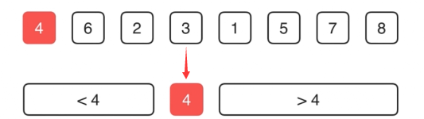

# Leetcode 215 第k大的元素

## **方法1：暴力解法**

排序后直接取第k大元素，时间复杂度为O(nlog⁡n)

## **方法2：维护一个堆**

建立容量为k的最小值堆，这样堆顶的元素就是题目所求。遍历完数组后，堆里存放的是最大的k个元素，且堆顶就是其中的最小值

时间 O(nlogk) 空间O(k)

也可以直接使用leetcode内置的 import { MinPriorityQueue } from '@datastructures-js/priority-queue';

## **方法3：快排partition**

<font color=red>确定数据量的情况下寻找第k大的数，可以利用快速选择算法</font>

<i>快速选择算法：快速排序算法中的轴值计算</i>

* **快排每次partition后，pivot会被放置在其最终排序位置**
* 根据pivot位置决定继续处理左半部分或右半部分
* 时间复杂度O(n)

例：在一个整数序列中寻找第k大的元素。如给定数组[3,2,1,5,6,4],k=2,结果为5。

- 选择标定点(如4)进行partition操作
- 操作后数组形态：标定点前的元素都小于它，后的元素都大于它
- 示例：数组经过partition后变为[2,3,1,4,6,5]
- 若寻找第2大元素，只需在大于4的部分([6,5])继续查找



解答：

降序分区,调用 `partition(nums, l, r)` 后，数组被分为三部分：

```typescript
[l ... p-1]  |  [p]  |  [p+1 ... r]
  > nums[p]  | 基准值 |  < nums[p]
（更大元素） |       | （更小元素）
```

**基准元素 `nums[p]` 的全局排名 = `p`**
（因为左侧有 `p` 个元素比它大，所以它是第 `p+1` 大 → 0 索引排名为 `p`）


```js
function partition(nums: number[], l: number, r: number): number {
  let p = l + Math.floor(Math.random() * (r - l + 1)); // 随机选择一个基准

  [nums[l], nums[p]] = [nums[p], nums[l]]; // 将基准交换到开头

  let lt = l + 1; //[l+1,lt) >p, [lt,i) <p
  for (let i = l + 1; i <= r; i++) {
    if (nums[i] > nums[l]) {
      [nums[i], nums[lt]] = [nums[lt], nums[i]]; // 将大于基准的元素交换到 lt 位置
      lt++;
    }
  }
  [nums[l], nums[lt - 1]] = [nums[lt - 1], nums[l]]; // 将基准放到正确位置
  return lt - 1;
}

function findKthLargestHelper(
  nums: number[],
  l: number,
  r: number,
  k: number,
): number {
  if (l === r) return nums[l]; //特殊情况，只有一个元素

  let p = partition(nums, l, r); // 获取基准位置

  if (k === p) {
    return nums[p];
  } else if (k < p) {
    return findKthLargestHelper(nums, l, p - 1, k); // 在左侧继续查找
  } else {
    return findKthLargestHelper(nums, p + 1, r, k); // 在右侧继续查找
  }
}

function findKthLargest(nums: number[], k: number): number {
  return findKthLargestHelper(nums, 0, nums.length - 1, k - 1); // k-1 因为索引从 0 开始
}

```

时间平均 O(n) 最坏O(n^2)

问题：对有大量重复元素的测试用例，会超出时间限制，退化成O（n2）

### 优化：三路分区

```typescript
// 三路分区优化版
function findKthLargestHelperQuick3Way(
  nums: number[],
  l: number,
  r: number,
  k: number,
): number {
  if (l >= r) return nums[l]

  // 三路分区：[l+1, lt) > pivot, [lt, gt) == pivot, [gt, r] < pivot
  const rand = l + Math.floor(Math.random() * (r - l + 1));
  [nums[l], nums[rand]] = [nums[rand], nums[l]];

  const pivot = nums[l];
  let lt = l + 1; // 大于 pivot 的右边界
  let gt = r; // 小于 pivot 的左边界

  let i = l + 1;
  while (i <= gt) {
    if (nums[i] > pivot) {
      [nums[i], nums[lt]] = [nums[lt], nums[i]];
      lt++;
      i++;
    }else if (nums[i] < pivot) {
      [nums[i], nums[gt]] = [nums[gt], nums[i]];
      gt--;
      // i不变，因为交换过来的元素还未检查
    }else{
      i++; //等于pivot，跳过
    }
  }
  
  // 将pivot放到中间正确位置
  [nums[l], nums[lt - 1]] = [nums[lt - 1], nums[l]];
  const pivotLeft = lt - 1; // pivot的区间左边界
  const pivotRight = gt; // pivot的区间右边界
  
  // 三路决策
  if(k<pivotLeft){
    return findKthLargestHelperQuick3Way(nums, l, pivotLeft - 1, k);
  }else if(k>pivotRight){
    return findKthLargestHelperQuick3Way(nums, pivotRight + 1, r, k);
  }else{
    return nums[k]; // k在pivot区间内，直接返回
  }
}

function findKthLargest1(nums: number[], k: number): number {
  return findKthLargestHelperQuick3Way(nums, 0, nums.length - 1, k - 1); 
}
```

