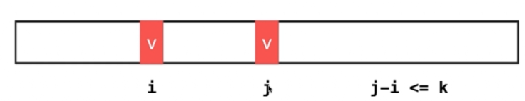
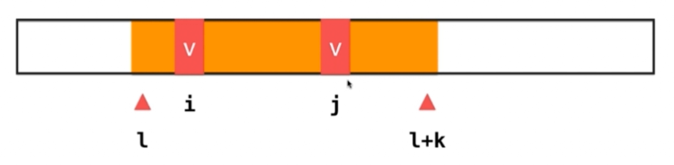

# Leetcode：219存在重复元素||

> 题目转变为：能不能找到一个长度为K的区间，其中有两个相等元素




```js
/**
 * @param {number[]} nums
 * @param {number} k
 * @return {boolean}
 */
var containsNearbyDuplicate = function(nums, k) {

  if(nums.length<=1) return false;
  if(k<=0) return false;

  let set = new Set();
  for(let i=0;i<nums.length;i++){
    if(set.has(nums[i])){
      return true;
    }

    set.add(nums[i]);
    
    // 保持set中最多有K个元素
    // 因为在下一次循环中会添加一个新元素，使得总共考虑k+1个元素
    if(set.size === k+1){
      set.delete(nums[i-k]);
    }
  }
  return false;

};

```

```py
class Solution:
    def containsNearbyDuplicate(self, nums: list[int], k: int) -> bool:
        if k<=0: return False
        s = set()
        for i in range(len(nums)):
            if nums[i] in s:
                return True
            s.add(nums[i])

            if len(s) == k + 1:
                s.remove(nums[i-k])
        return False
```

Python 版思路与 JS 一致：`s` 里始终只保留最近 k 个元素，因此 `nums[i] in s` 命中就意味着存在距离 ≤ k 的相同元素。每轮 `add` 后窗口临时变成 k+1 个，用 `remove(nums[i-k])` 挤掉最左边那个来维持不变式；这一步是算法正确的关键，否则窗口外的旧值会造成误判。Python 的 `set` 同样是哈希集合，`in` / `add` / `remove` 平均 O(1)。

// 时间复杂度: O(n)
// 空间复杂度: O(k)