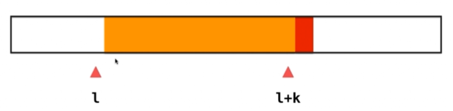
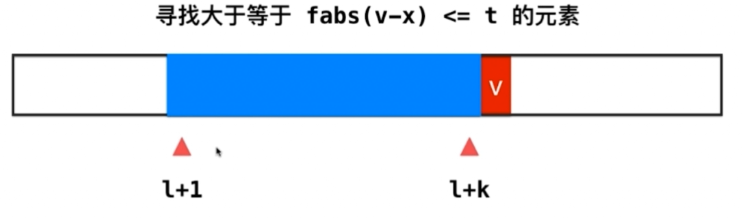
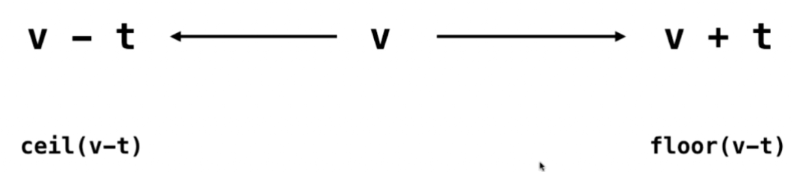

# Leetcode：220 存在重复元素 III

题目要求：找两个下标 i、j，满足 |i - j| <= k（索引差）且 |nums[i] - nums[j]| <= t（值差）。

还是使用滑动窗口：




v的范围：


JS中没找到合适的数据结构

所以参考了@liuyubobobo的JAVA和C++代码

```java
import java.util.TreeSet;

// 220. Contains Duplicate III
// https://leetcode.com/problems/contains-duplicate-iii/description/
// 时间复杂度: O(nlogk)
// 空间复杂度: O(k)
public class Solution {

    public boolean containsNearbyAlmostDuplicate(int[] nums, int k, int t) {

        // 这个问题的测试数据在使用int进行加减运算时会溢出
        // 所以使用long long
        TreeSet<Long> record = new TreeSet<Long>();
        for(int i = 0 ; i < nums.length ; i ++){

            if(record.ceiling((long)nums[i] - (long)t) != null &&
                    record.ceiling((long)nums[i] - (long)t) <= (long)nums[i] + (long)t)
            return true;

            record.add((long)nums[i]);

            if(record.size() == k + 1)
                record.remove((long)nums[i-k]);
        }

        return false;
    }

    private static void printBool(boolean b){
        System.out.println(b ? "True" : "False");
    }

    public static void main(String[] args) {

        int[] nums = {-2147483648, -2147483647};
        int k = 3;
        int t = 3;
        printBool((new Solution()).containsNearbyAlmostDuplicate(nums, k, t));
    }
}
```

```c++
#include <iostream>
#include <vector>
#include <set>
#include <cassert>
#include <stdexcept>
#include <cmath>

using namespace std;

// 220. Contains Duplicate III
// https://leetcode.com/problems/contains-duplicate-iii/description/
// 时间复杂度: O(nlogk)
// 空间复杂度: O(k)
class Solution {
public:
    bool containsNearbyAlmostDuplicate(vector<int>& nums, int k, int t) {

        // 这个问题的测试数据在使用int进行加减运算时会溢出
        // 所以使用long long
        set<long long> record;
        for(int i = 0 ; i < nums.size() ; i ++){

            if(record.lower_bound((long long)nums[i] - (long long)t) != record.end() &&
                *record.lower_bound((long long)nums[i] - (long long)t ) <= (long long)nums[i] + (long long)t)
                return true;

            record.insert(nums[i]);

            if(record.size() == k + 1)
                record.erase( nums[i-k] );
        }

        return false;
    }
};

int main() {

    int nums[] = {-2147483648, -2147483647};
    vector<int> vec(nums, nums + sizeof(nums)/sizeof(int));
    int k = 3;
    int t = 3;

    if(Solution().containsNearbyAlmostDuplicate(vec, k, t))
        cout << "true" << endl;
    else
        cout << "false" << endl;

    return 0;
}
```

## 解法二：分桶（鸽笼原理）

有序集合解法需要 O(log k) 查找 ceiling，而 Python 标准库没有有序集合。改用分桶可以把查找降到 O(1)：

把数轴按桶宽 `w = t + 1` 切成一段段区间，元素 `v` 的桶编号为 `v // w`（向下取整，负数也正确）。桶宽取 t+1 保证两条性质：

1. **同桶必命中**：同桶内任意两数之差 ≤ t，窗口内若已有元素与 v 同桶，直接返回 true；
2. **命中必在同桶或邻桶**：值差 ≤ t 的两数不可能隔着一个桶以上，所以只需再检查 `bid-1`、`bid+1` 两个邻桶（邻桶元素不一定真满足，需用 abs 验证一次）。

桶用字典存储，同时充当滑动窗口：每轮插入 v 的桶，当 `i >= k` 时删掉 `nums[i-k]` 的桶，保证桶里只留索引差 ≤ k 的元素。窗口内同桶不可能共存两个元素（插入第二个时已经返回 true），所以删除不会误删。

```
t = 2 时 w = 3
桶 -1:  [-3, -1]
桶  0:  [ 0,  2]
桶  1:  [ 3,  5]
桶  2:  [ 6,  8]
```

时间复杂度 O(n)，空间复杂度 O(k)，优于有序集合解法的 O(n log k)。

```python
class Solution:
    def containsNearbyAlmostDuplicate(self, nums: list[int], k: int, t: int) -> bool:
        # 桶宽 t+1：同桶元素值差必 <= t，邻桶需再验证；// 向下取整保证负数分桶正确
        w = t + 1
        buckets: dict[int, int] = {}
        for i, v in enumerate(nums):
            bid = v // w
            if bid in buckets:
                return True
            if bid - 1 in buckets and abs(v - buckets[bid - 1]) <= t:
                return True
            if bid + 1 in buckets and abs(v - buckets[bid + 1]) <= t:
                return True
            buckets[bid] = v
            if i >= k:
                del buckets[nums[i - k] // w]
        return False
```